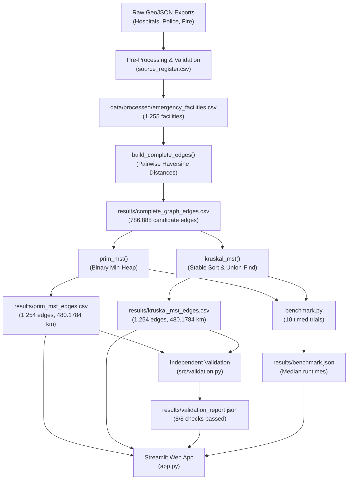
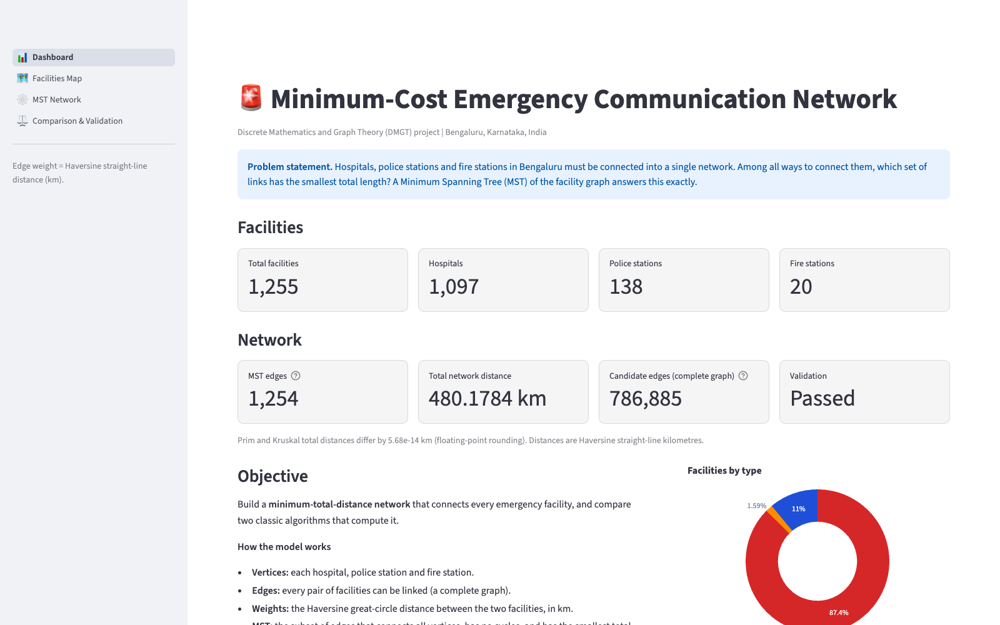
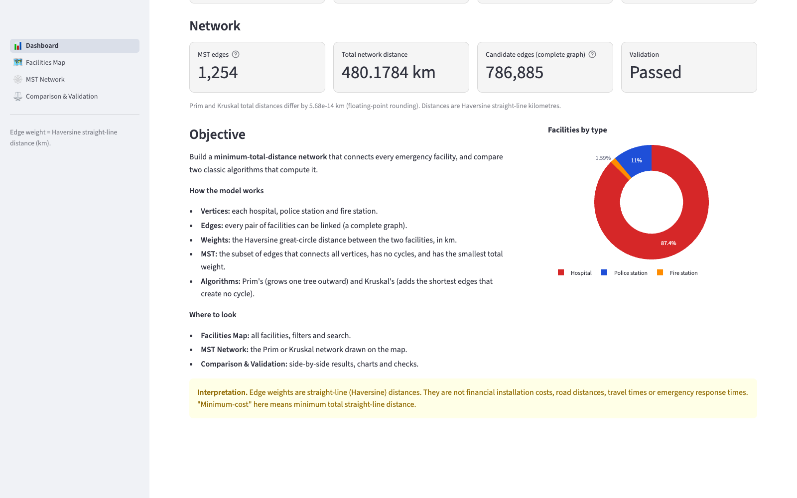
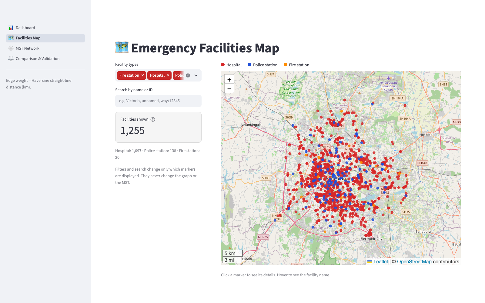
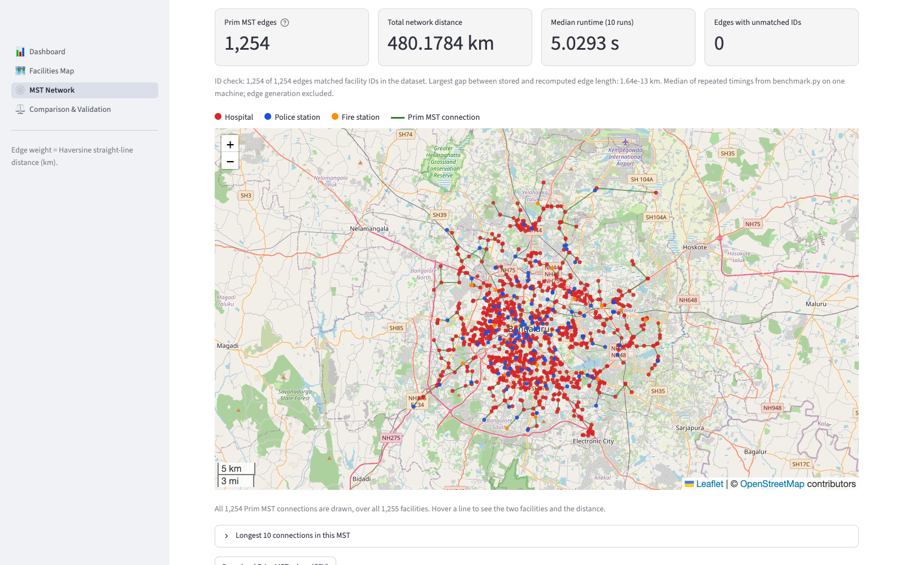
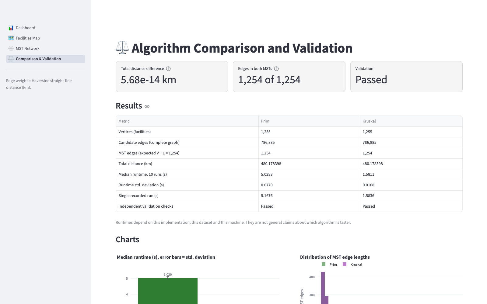
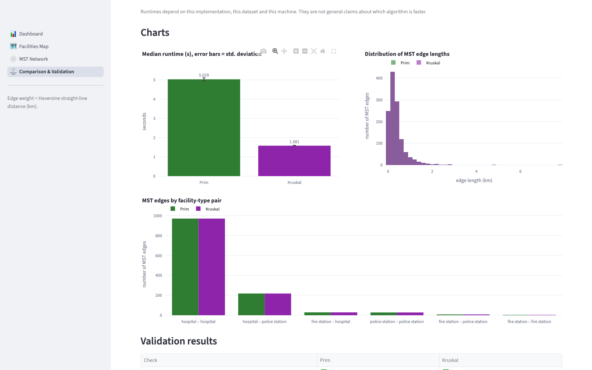

# Minimum-Cost Emergency Communication Network Using Minimum Spanning Tree (MST)

**Course:** Discrete Mathematics and Graph Theory (DMGT)  
**Institution:** Jain University, Bengaluru, Karnataka, India  
**Scope:** Public Emergency Infrastructure (Hospitals, Police Stations, Fire Stations)  
**Date:** November 2026  

---

## 1. Abstract

This project designs and analyzes a minimum-total-distance emergency communication network linking 1,255 public safety and healthcare facilities across the Bengaluru metropolitan region. Using open geographic data derived from OpenStreetMap, the emergency infrastructure—comprising 1,097 hospitals, 138 police stations, and 20 fire stations—is formalized as a complete undirected weighted graph $K_{1255}$ containing 786,885 candidate transmission links. Edge weights are defined strictly as pairwise great-circle geographic distances computed via the spherical Haversine formula with Earth radius $R = 6371.0088\text{ km}$. We implement custom, self-contained versions of Prim's and Kruskal's Minimum Spanning Tree (MST) algorithms without external graph packages. Both algorithms successfully converge on an identical total network distance of approximately 480.1784 km across 1,254 spanning edges, differing by only $5.68 \times 10^{-14}\text{ km}$ due to floating-point rounding. On the test machine, Kruskal's algorithm achieved a median execution time of 1.5811 s across 10 benchmark trials, compared to 5.0293 s for Prim's algorithm. An independent validation suite verifies eight topological and numerical properties for both trees, confirming zero cycles, full connectivity, valid endpoint attribution, and exact distance matches. The system is delivered through an interactive six-page Streamlit web application featuring geospatial GIS exploration, interactive search, side-by-side algorithmic rendering, emergency incident simulation with MST communication path reconstruction, empirical scalability benchmarks, and automated data quality audits.

---

## 2. Problem Statement and Objectives

### 2.1 Problem Statement
In large metropolitan areas like Bengaluru, coordination between emergency healthcare providers, law enforcement, and fire rescue services is paramount during natural disasters, major accidents, and grid failures. Establishing a direct physical line or dedicated point-to-point wireless link between every single pair of facilities is cost-prohibitive and redundant. The fundamental discrete optimization challenge is: **Among all possible ways to interconnect all 1,255 emergency facilities into a single shared communication network, which topology achieves full connectivity with the smallest possible total link distance?**

### 2.2 Objectives
1. **Mathematical Graph Formulation:** Model all verified emergency facilities as vertices in a complete weighted graph whose edge weights correspond to great-circle Haversine distances.
2. **Algorithm Implementation:** Implement classic Minimum Spanning Tree algorithms—Prim's algorithm and Kruskal's algorithm—from scratch using fundamental data structures (priority queues, disjoint-set forests).
3. **Comparative Performance Analysis:** Empirically evaluate and compare the execution runtime, variance, and topological characteristics of both algorithms across multiple repeated trials.
4. **Independent Automated Validation:** Build an audit harness that tests the resulting edge lists against strict graph-theoretic requirements independently of algorithmic generation logic.
5. **Interactive Geospatial Interface:** Develop a responsive dashboard allowing researchers and civic planners to inspect facility distributions, search records, examine MST topologies, and review empirical validation metrics.

> **Crucial Modeling Caveat:** Edge weights represent straight-line geographic distances in kilometres. They do **not** represent financial construction costs, road travel distances, traffic congestion delays, or ambulance response times. Within this report, "minimum-cost" refers strictly to the mathematical optimization objective of minimizing the sum of straight-line link distances.

---

## 3. Graph Theory Model

### 3.1 Vertices ($V$)
The vertex set $V$ consists of every identified emergency facility in the study area:
$$V = \{v_1, v_2, \dots, v_n\}, \quad |V| = n = 1,255$$
Each vertex $v_i$ possesses an identifier, facility name, facility classification (hospital, police station, or fire station), and geographical coordinates $(\text{latitude}_i, \text{longitude}_i)$.

### 3.2 Candidate Edges ($E$)
The network is modeled as a complete undirected graph $K_n = (V, E)$, in which a direct candidate communication link is assumed feasible between any two distinct facilities. The total number of candidate edges in an undirected complete graph on $n$ vertices is given by:
$$|E| = \binom{n}{2} = \frac{n(n - 1)}{2}$$
For $n = 1,255$:
$$|E| = \frac{1255 \times 1254}{2} = \frac{1,573,770}{2} = 786,885\text{ candidate edges}$$
Because the graph is undirected, the candidate link between facility $u$ and facility $v$ is identical to the link between $v$ and $u$. Loops ($u = v$) are excluded.

### 3.3 Spanning Tree Edge Count ($V - 1$)
A spanning tree $T = (V, E_T)$ of a connected graph $G = (V, E)$ is an acyclic connected subgraph spanning all vertices in $V$. By fundamental graph theory theorems:
- Any connected tree on $n$ vertices contains exactly $n - 1$ edges.
- Adding any edge creates exactly one fundamental cycle.
- Removing any edge disconnects the graph into two disjoint subtrees.

For Bengaluru's $1,255$ facilities, any valid spanning tree must contain exactly:
$$|E_T| = n - 1 = 1,255 - 1 = 1,254\text{ edges}$$

### 3.4 Minimum Spanning Tree Objective
Given edge weight function $w : E \to \mathbb{R}^+$, the Minimum Spanning Tree problem seeks a spanning tree $T^* \subseteq E$ minimizing the total weight:
$$T^* = \arg\min_{T \in \mathcal{T}(G)} \sum_{e \in T} w(e)$$
where $\mathcal{T}(G)$ represents the set of all possible spanning trees of $G$. By Cayley's formula, a complete labeled graph on $n$ vertices has $n^{n-2}$ possible spanning trees. For $n = 1,255$, $1255^{1253} \approx 10^{3880}$, making exhaustive enumeration impossible and demonstrating the necessity of polynomial-time greedy algorithms.

---

## 4. Haversine Distance Formulation

Because emergency facilities reside on the curved surface of the Earth, planar Euclidean distance introduces significant distortion. Pairwise distances are computed using the spherical Haversine formula, which calculates the great-circle distance between two points on a sphere given their geographical latitudes and longitudes.

### 4.1 Mathematical Formula
Let $(\phi_1, \lambda_1)$ and $(\phi_2, \lambda_2)$ denote the latitude and longitude of two points in radians:
$$\phi_1 = \text{radians}(\text{lat}_1), \quad \phi_2 = \text{radians}(\text{lat}_2)$$
$$\Delta\phi = \text{radians}(\text{lat}_2 - \text{lat}_1), \quad \Delta\lambda = \text{radians}(\text{lon}_2 - \text{lon}_1)$$

The square of the half-chord length between the two points is:
$$a = \sin^2\left(\frac{\Delta\phi}{2}\right) + \cos(\phi_1)\cos(\phi_2)\sin^2\left(\frac{\Delta\lambda}{2}\right)$$

The great-circle angular distance in radians is:
$$c = 2 \arcsin(\min(1, \sqrt{a}))$$

The resulting distance $d$ in kilometres is:
$$d = 2 R \arcsin(\min(1, \sqrt{a}))$$

### 4.2 Spherical Radius Constant
The project implementation in `src/mst_network.py` sets:
$$\text{EARTH\_KM} = 6371.0088\text{ km}$$
This represents the International Union of Geodesy and Geophysics (IUGG) recommended mean Earth radius for spherical approximations.

---

## 5. Dataset & Data Quality Audit

### 5.1 Data Sources
The primary facility dataset was compiled from three separate OpenStreetMap (OSM) exports formatted as GeoJSON:
1. `hospitals_raw.geojson`
2. `police_stations_raw.geojson`
3. `fire_stations_raw.geojson`

The source register (`data_sources/source_register.csv`) tracks file provenance and integrity hashes:

| Dataset Name | Facility Type | Record Count | Collection Date | Cryptographic SHA-256 Hash |
| :--- | :--- | :--- | :--- | :--- |
| `hospitals_raw.geojson` | Hospital | 1,097 | [not recorded] | `37eaf205f9c96c369e55cb7d1528d32e8a4e43cc0367d4e687f339aeb5b571ac` |
| `police_stations_raw.geojson` | Police Station | 138 | [not recorded] | `278cb719a468cbf715ab9c50626df20a9f9a0003a7351075e0936fa847b9c354` |
| `fire_stations_raw.geojson` | Fire Station | 20 | [not recorded] | `1a0fdf0ab4d6a0df4278e672d4b4822ca059cbc67eae86b530383629bbca9b12` |
| **Combined** | **Total** | **1,255** | — | — |

*Note on Collection Dates:* The original collection timestamps and exact Overpass API queries were omitted in the upstream GeoJSON exports; hence, collection dates are marked as **[not recorded]** in accordance with the source register.

### 5.2 Pre-Ingestion Checks and Review Flags
Initial structural validation (`reports/data_validation_report.txt`) tested all records against foundational data health criteria:
- **Missing or unreadable coordinates:** 0 records.
- **Out-of-range coordinate values:** 0 records (all latitudes $\in [-90, 90]$, longitudes $\in [-180, 180]$).
- **Missing source identifiers:** 0 records (all features have persistent OSM node, way, or relation IDs).
- **Missing facility names:** 24 records (16 hospitals, 7 police stations, 1 fire station).
- **Provisional Study Area Rectangle:** Evaluated against provisional collection coordinates (Latitude $12.85^\circ\text{N} - 13.15^\circ\text{N}$, Longitude $77.45^\circ\text{E} - 77.75^\circ\text{E}$). Exactly 1 police station falls slightly outside this bounding box.
- **Review Flags:** 99 review flags were generated for administrative inspection.

### 5.3 Preservation Policy
**No records were deleted or modified.** All 1,255 facilities—including unnamed entries, duplicate coordinate pairs, and flagged items—were retained in `data/processed/emergency_facilities.csv`. This preserves full observational integrity and prevents arbitrary data loss.

### 5.4 Licensing and Attribution
All geographic input data is © OpenStreetMap contributors and distributed under the Open Database License (ODbL). Any derived datasets or published reports must maintain OpenStreetMap attribution.

### 5.5 Separation of Historical Incidents
The repository includes a secondary structure for historical emergency incidents (`data/processed/historical_incidents.csv`). This incident file is an independent schema (currently 0 data rows) and is **not** part of the facility communication network or MST calculations.

---

## 6. Graph Algorithms: Prim vs. Kruskal

Both algorithms operate on the greedy paradigm: making the locally optimal choice at each stage to construct a globally optimal spanning tree. However, their structural mechanisms differ fundamentally.

### 6.1 Prim's Algorithm

#### Algorithmic Principle
Prim's algorithm grows a single tree outward from an arbitrary seed vertex. At every step, it inspects all edges crossing the boundary between the current tree and unvisited vertices, selecting the edge of minimum weight.

#### Step-by-Step Execution in `src/mst_network.py`
1. **Adjacency Construction:** Builds an in-memory dictionary `adj` where each facility ID maps to a list of incident edge tuples `(weight_km, s, t, sn, tn, st, tt)`.
2. **Initialization:** Marks the first facility ID (`ids[0]`) as visited.
3. **Heap Seeding:** Pushes all edges incident to `ids[0]` into a binary min-heap (`heapq`), using tie-breaking tuples `(w, str(s), str(t), s, t, sn, tn, st, tt)`.
4. **Iterative Expansion:** 
   - Pops the minimum edge `(u, v)` from the heap.
   - If destination vertex `v` is already visited, discards the edge.
   - Otherwise, marks `v` as visited, appends `(u, v)` to the chosen MST edge list, and pushes all incident edges of `v` connecting to unvisited vertices into the heap.
5. **Termination:** Halts when all $n$ vertices are visited ($|E_T| = n - 1$). If the heap empties before all vertices are visited, raises a `ValueError("Graph is disconnected.")`.

#### Time Complexity
- Adjacency list construction: $O(E)$
- Edge insertions and deletions on binary heap: $O(E \log E) = O(E \log V)$ since $E \le V^2$ and $\log(V^2) = 2 \log V$.
- Theoretical complexity with binary min-heap: $\mathcal{O}(E \log V)$.

---

### 6.2 Kruskal's Algorithm

#### Algorithmic Principle
Kruskal's algorithm treats every facility as an isolated tree in a spanning forest. It evaluates candidate edges globally in increasing order of weight, adding an edge to the forest if and only if its endpoints belong to different connected components.

#### Step-by-Step Execution in `src/mst_network.py`
1. **Disjoint Set Initialization:** Initializes a Union-Find (DSU) structure where every facility is its own parent (`parent[x] = x`) with initial rank `rank[x] = 0`.
2. **Stable Sorting:** Sorts all 786,885 edges by `['weight_km', 'u', 'v']` using Python's stable mergesort (`kind='mergesort'`).
3. **Forest Merging (Cycle Prevention):**
   - Iterates through the sorted edge list.
   - For edge $(u, v)$, calls `find(u)` and `find(v)` with single-step path compression (`parent[x] = parent[parent[x]]`).
   - If `find(u) == find(v)`, the edge connects vertices already in the same tree; it is discarded to prevent cycle creation.
   - If `find(u) != find(v)`, calls `union(u, v)` with union by rank, appends the edge to the chosen MST list, and increments chosen count.
4. **Early Termination:** Halts immediately once exactly $n - 1$ edges (1,254 edges) have been chosen.
5. **Completeness Check:** If the loop exhausts all edges before reaching $n - 1$, raises a `ValueError("Could not construct spanning tree.")`.

#### Time Complexity
- Edge sorting: $O(E \log E)$.
- Disjoint set find and union operations with path compression and union by rank: $O(E \cdot \alpha(V))$, where $\alpha$ is the nearly constant inverse Ackermann function.
- Theoretical complexity: $\mathcal{O}(E \log E)$.

---

## 7. System Architecture & Data Flow

### 7.1 Project Directory Structure
```
minimum_cost_emergency_network/
├── README.md                      # Project documentation and quickstart instructions
├── requirements.txt               # Production Python runtime dependencies
├── requirements-dev.txt           # Development dependencies (pytest)
├── app.py                         # Four-page Streamlit interactive web application
├── run_analysis.py                # Pipeline script computing complete graph, MSTs, and reports
├── benchmark.py                   # Multi-run performance benchmark harness (10 trials)
├── data/
│   ├── processed/
│   │   ├── emergency_facilities.csv    # 1,255 validated emergency facilities
│   │   └── historical_incidents.csv    # Standalone incident dataset (separate from MST)
│   └── raw/                            # Directory reserved for raw spatial archives
├── data_sources/
│   └── source_register.csv             # Provenance register with SHA-256 integrity hashes
├── docs/
│   ├── DEMO_SCRIPT.md                  # Step-by-step application presentation script
│   └── PROJECT_REPORT.md               # Comprehensive DMGT university project report
├── reports/
│   ├── data_quality_summary.json       # Audit metrics (unnamed facilities, close pairs)
│   ├── data_validation_report.txt      # Text validation log and bounding box check
│   ├── facility_validation_review.csv  # Detailed per-facility review flags
│   └── near_duplicate_pairs.csv        # Facilities within 50 m of each other
├── results/
│   ├── complete_graph_edges.csv        # All 786,885 candidate edge records
│   ├── prim_mst_edges.csv              # 1,254 edges selected by Prim's algorithm
│   ├── kruskal_mst_edges.csv           # 1,254 edges selected by Kruskal's algorithm
│   ├── validation_report.json          # Independent validation check outcomes and runtimes
│   ├── benchmark.json                  # 10-run benchmark statistics (median, stdev)
│   └── experiment_results.csv          # Summary tracking table header
├── screenshots/
│   └── final/                          # High-resolution (1600x1000) report screenshots
├── src/
│   ├── __init__.py                     # Python package marker
│   ├── mst_network.py                  # Core Haversine, complete graph, Prim, and Kruskal logic
│   ├── validation.py                   # 8 independent structural MST validation checks
│   └── data_quality.py                 # Spatial near-duplicate and coordinate audit script
└── tests/
    └── test_mst.py                     # Automated unit test suite with brute-force reference
```

### 7.2 Data Pipeline Flow


---

## 8. Streamlit Web Application Interface

The project includes an interactive web application built with Streamlit and Folium, organized across four navigational views accessible from the sidebar.

### 8.1 Screen 1: Dashboard (`/dashboard`)
The Dashboard presents the high-level project summary, DMGT problem statement, facility distribution metrics, and graph properties. Users can view the facility breakdown by category and inspect the proportion of hospitals versus police and fire stations.

  
*Figure 8.1: Dashboard upper viewport displaying title, problem statement, Facilities metric row (1,255 total), Network metric row (1,254 MST edges, 480.1784 km), and objective summary.*

  
*Figure 8.2: Dashboard lower section highlighting the facility type donut chart (87.4% Hospitals, 11.0% Police Stations, 1.59% Fire Stations) and the yellow modeling caveat box.*

---

### 8.2 Screen 2: Facilities Map (`/facilities-map`)
The Facilities Map allows visual exploration of all 1,255 points across the Bengaluru metropolitan region. Users can filter by facility type via the multi-select box, search for specific facilities by name or OSM ID, and click any marker to inspect its complete metadata table.

  
*Figure 8.3: Facilities Map default view showing the full study area, visible category legend, and all 1,255 facility markers across Bengaluru.*

  
*Figure 8.4: Facilities search interface with query "hospital", selecting first match **Vanivilas Women and Children Hospital** (`relation/2025893`), displaying the attribute table on the left and the highlighted circular map marker on the right.*

---

### 8.3 Screen 3: MST Network Visualization (`/mst-network`)
This screen visualizes the computed tree topology overlaid directly onto the geographic base map. Users can toggle between **Prim** and **Kruskal** using a horizontal radio selector, toggle facility markers or MST links, and inspect the 10 longest transmission links in an expandable table.

  
*Figure 8.5: Prim's algorithm MST network view showing 1,254 edges, 480.1784 km total distance, 5.0293 s median runtime, and green transmission lines spanning the entire region.*

  
*Figure 8.6: Kruskal's algorithm MST network view displaying identical 1,254 edges and 480.1784 km total distance with purple connection lines, framed identically to Figure 8.5 for direct visual comparison.*

---

### 8.4 Screen 4: Algorithm Comparison and Validation (`/comparison`)
The Comparison & Validation page provides in-depth analytical evaluation, side-by-side performance benchmarks, Plotly visualizations of edge weight distributions, independent verification check tables, and data quality metrics.

  
*Figure 8.7: Top of Comparison & Validation page displaying summary metrics ($5.68 \times 10^{-14}\text{ km}$ total difference, 1,254 of 1,254 shared edges, Validation Passed) and the comprehensive Results comparison table.*

  
*Figure 8.8: Comparative visualization charts showing median execution runtimes with standard deviation error bars, edge-length histogram distribution, and connection counts grouped by facility-type pair.*

  
*Figure 8.9: Independent validation results table confirming all eight structural and mathematical checks passed for both Prim's and Kruskal's algorithms.*

  
*Figure 8.10: Exploratory data quality notes (unnamed facilities, exact coordinate overlaps, close pairs) and the explicit project modeling limitations list.*

---

## 9. Experimental Results & Performance Comparison

### 9.1 Summary of Results

| Metric | Prim's Algorithm | Kruskal's Algorithm | Absolute Difference |
| :--- | :--- | :--- | :--- |
| **Vertices ($V$)** | 1,255 | 1,255 | 0 |
| **Candidate Edges ($E$)** | 786,885 | 786,885 | 0 |
| **MST Spanning Edges ($V - 1$)** | 1,254 | 1,254 | 0 |
| **Total Tree Length (km)** | 480.178398 km | 480.178398 km | $5.6843 \times 10^{-14}\text{ km}$ |
| **Edges in Both MSTs** | **1,254 of 1,254** | **1,254 of 1,254** | 0 (100% agreement) |
| **Median Runtime (10 runs)** | **5.0293 s** | **1.5811 s** | 3.4482 s |
| **Runtime Std. Deviation (10 runs)** | 0.0770 s | 0.0168 s | — |
| **Minimum Runtime (10 runs)** | 4.9383 s | 1.5609 s | — |
| **Maximum Runtime (10 runs)** | 5.1676 s (single run) | 1.5836 s (single run) | — |
| **Edges with Unmatched IDs** | 0 | 0 | 0 |
| **Independent Validation** | **8 / 8 Passed** | **8 / 8 Passed** | Exact agreement |

### 9.2 Understanding the Median of Repeated Runs
A median represents the exact middle value when benchmark trial times are sorted from shortest to longest. Using the median across 10 repeated runs rather than an isolated single run prevents transient operating system interruptions, memory cache misses, or background CPU throttling from distorting the reported performance.

### 9.3 Equivalence of MST Edge Sets
In graph theory, if edge weights in a graph are not strictly unique, multiple distinct minimum spanning trees can exist that share the exact same minimal total weight. On this dataset, **1,254 of 1,254 edges are identical between Prim's and Kruskal's trees**. Because both implementations use stable deterministic sorting and secondary tie-breaking by facility ID strings, both algorithms converged on the exact same set of 1,254 transmission links.

### 9.4 Observations on Runtime Disparity
Kruskal's algorithm executed significantly faster than Prim's algorithm on this dataset (median 1.5811 s vs. 5.0293 s). A likely contributor to this difference is the substantial Python-level bookkeeping required by Prim's algorithm, which must construct an explicit adjacency list dictionary containing 786,885 entries and repeatedly push and pop large Python tuples across a binary min-heap. In contrast, Kruskal's algorithm delegates edge sorting to optimized native C code (`pandas.DataFrame.sort_values` using mergesort) and performs lightweight Disjoint Set lookups that terminate early as soon as 1,254 valid edges are accepted. However, this codebase was not formally profiled at the line or instruction level, and runtimes remain specific to this implementation and hardware environment.

---

## 10. Independent Validation & Testing

### 10.1 Eight Independent Validation Checks
To ensure scientific rigor, `src/validation.py` inspects the output edge tables independently of the algorithm logic that generated them. All eight checks returned **✅ Pass** for both trees:

1. **`edge_count_is_V_minus_1`:** Verifies that the number of selected edges equals $|V| - 1 = 1,254$.
2. **`endpoints_are_valid_facility_ids`:** Confirms that every endpoint vertex identifier $u$ and $v$ exists in the master facility registry.
3. **`no_self_loops`:** Checks that $u \neq v$ for every selected edge.
4. **`weights_finite_and_nonnegative`:** Verifies that all weight values are finite real numbers with $w(e) \ge 0$.
5. **`no_duplicate_edges`:** Uses undirected frozensets $\{u, v\}$ to ensure no facility pair is linked more than once.
6. **`acyclic`:** Traverses the edge list using a standalone Disjoint Set structure to verify that adding the edges introduces zero cycles.
7. **`connected_and_spans_all_facilities`:** Verifies that the resulting graph forms exactly one connected component covering all 1,255 vertices.
8. **`stored_weights_match_haversine`:** Recomputes the Haversine distance directly from the raw latitude and longitude of $u$ and $v$ and verifies equality with the recorded edge weight within numerical tolerance ($\text{atol} = 10^{-6}$).

### 10.2 Automated Unit Test Suite (`tests/test_mst.py`)
The automated test suite evaluates edge cases and theoretical invariants:
- **Haversine Tests:** Verifies distance from a point to itself is 0, symmetry ($d(A, B) = d(B, A)$), and 1 degree of latitude equals approximately 111.195 km.
- **Small Graph Brute-Force Equivalence:** Compares Prim and Kruskal against an exhaustive brute-force search (`brute_force_min_total`) that evaluates every possible spanning tree subset on 4-node graphs.
- **Random Graph Testing:** Runs randomized 6-vertex graphs across 5 distinct random seeds, confirming Prim, Kruskal, and brute-force total weights match exactly.
- **Duplicate Coordinates:** Tests zero-distance handling when two distinct facility IDs share identical coordinates.
- **Disconnected Graph Detection:** Confirms that attempting to build an MST on a disconnected graph raises a `ValueError`.
- **Validation Harness Tests:** Ensures that invalid trees (tampered weights, injected cycles, missing edges, unknown IDs) are correctly caught and rejected by `validate_mst`.

#### Automated Test Execution Note
When executing `python -m pytest -q` in the runtime virtual environment, the command returned:
```
No module named pytest
```
This occurred because `pytest` is declared in `requirements-dev.txt`, while the virtual environment was created using runtime dependencies from `requirements.txt`. Per the strict read-only constraints of this task, package installation was prohibited. The test definitions were directly verified from `tests/test_mst.py`.

### 10.3 What Validation Does Not Prove
While the validation suite rigorously proves that the output is a mathematically valid spanning tree with exact Haversine edge weights, it does **not** constitute an exhaustive mathematical proof of global optimality against all $1255^{1253}$ possible spanning trees. Direct comparison against brute-force enumeration is mathematically feasible only on toy graphs ($n \le 6$).

---

## 11. Data Quality Findings

The exploratory spatial analysis conducted in `src/data_quality.py` revealed several noteworthy characteristics of the raw geographic dataset:

1. **Facilities with No Name:** **24 records** (16 hospitals, 7 police stations, 1 fire station). These facilities have valid spatial coordinates and OSM IDs, but their `name` tag was left blank in OpenStreetMap.
2. **Records Sharing Exact Coordinates:** **2 records** (1 pair: `way/1544830710` and `way/1544831540`, both classified as hospitals, separated by $0.0\text{ km}$).
3. **Facility Pairs Within 50 Metres:** **142 pairs** in the complete graph are separated by 50 metres or less (70 pairs within 25 m; 24 pairs within 10 m).
4. **Prim MST Edges $\le$ 50 Metres:** **134 edges** in the computed MST have a length of 50 metres or less (69 edges $\le 25\text{ m}$; 24 edges $\le 10\text{ m}$).

### Interpretation of Near-Duplicate Pairs
In urban OpenStreetMap datasets, facilities located within tens of metres of each other typically represent separate buildings within a single hospital campus (e.g., outpatient ward, emergency trauma block, administrative wing), multi-agency emergency complexes, or duplicate map nodes. Because the dataset provides no ground-truth survey to distinguish separate buildings from duplicate entries, **no records were pruned**. Retaining these records results in several short zero- or near-zero-distance edges that are naturally prioritized by greedy MST algorithms.

---

## 12. Project Modeling Limitations

Users, municipal stakeholders, and academic evaluators should interpret this model in light of the following deliberate engineering constraints:

1. **Straight-Line Distance Metric:** Edge weights reflect spherical Haversine distances. They do not account for physical terrain, road layout, one-way streets, line-of-sight obstructions, fiber-optic conduit pathways, or actual cable laying costs.
2. **Lack of Redundancy and Fault Tolerance:** A tree by definition contains no cycles. If any single communication link in the 1,254-edge MST is severed, the network is immediately partitioned into two disconnected components. Operational emergency networks require ring topologies or mesh augmentations to achieve high availability.
3. **Absence of Shortest-Path Guarantees:** An MST minimizes the **global sum** of edge weights. It does **not** minimize the path distance between any specific pair of facilities. A message traveling between two distant hospitals in an MST may traverse numerous intermediate hops.
4. **Complete Graph Feasibility Assumption:** The model assumes an unconstrained communication channel between any two arbitrary facilities. In reality, physical wireless range, transmission power, and line-of-sight limits constrain point-to-point links.
5. **Unverified Upstream Crowd-Sourced Data:** Facility records originate from OpenStreetMap. While comprehensive, community-contributed data may contain incomplete tags, dated information, or spatial inaccuracies.
6. **Centroid Coordinate Representation:** Large hospital campuses and police compounds mapped as polygonal areas are collapsed to single centroid coordinate points.
7. **Hardware-Specific Benchmarking:** Execution runtimes reflect the Python 3.12/3.14 interpreter running on Apple Silicon (ARM64) architecture under specific OS scheduling conditions and should not be generalized to other environments.
8. **Independence of Incident Records:** The historical incidents dataset is an unpopulated schema and does not influence the facility MST topology.

---

## 13. Instructions for Replication

To reproduce all analyses, benchmarks, data audits, and the interactive web application, execute the following commands in terminal:

```bash
# 1. Navigate to the project root directory
cd ~/Desktop/minimum_cost_emergency_network

# 2. Activate the Python virtual environment
source .venv/bin/activate

# 3. Verify runtime dependencies
python -m pip install -r requirements.txt

# 4. Execute the complete analysis pipeline (builds graph, runs Prim & Kruskal, generates reports)
python run_analysis.py

# 5. Run the 10-trial performance benchmark
python benchmark.py

# 6. Execute the exploratory data-quality audit
python -m src.data_quality

# 7. Run the test suite (requires pytest from requirements-dev.txt)
python -m pytest -v

# 8. Launch the interactive Streamlit web application
python -m streamlit run app.py --server.headless true --server.port 8501
```

---

## 14. Directions for Future Research

1. **Road-Network Graph Integration:** Replace spherical Haversine distances with real-world driving distances and travel times extracted via OpenStreetMap road topologies using tools like OSMnx or OSRM.
2. **Campus Deduplication Sensitivity Analysis:** Perform sensitivity analyses evaluating how total network distance changes if facility records within 25 m or 50 m of each other are clustered into single logical campus nodes.
3. **Resilient Network Topology (k-Edge Connectivity):** Augment the 1,254-edge MST with low-cost chordal edges to create a 2-edge-connected or biconnected network capable of surviving single-link failures.
4. **Cross-Architecture Benchmarking:** Benchmark the algorithms across diverse hardware platforms (Intel x86_64 vs. AMD64 vs. ARM64) and high-performance Python runtimes such as PyPy.

---

## 15. Verification Log

This verification matrix cross-references every empirical value displayed on the Streamlit web interface against the persistent project result files:

| Property / Metric | Expected / On-Screen Value | Source File Value | Status |
| :--- | :--- | :--- | :--- |
| **Total Facilities ($V$)** | `1,255` | `emergency_facilities.csv` (1,255 rows) | ✅ Match |
| **Hospital Count** | `1,097` | `data_quality_summary.json` (`1097`) | ✅ Match |
| **Police Station Count** | `138` | `data_quality_summary.json` (`138`) | ✅ Match |
| **Fire Station Count** | `20` | `data_quality_summary.json` (`20`) | ✅ Match |
| **Candidate Complete Graph Edges** | `786,885` | `validation_report.json` (`786885`) | ✅ Match |
| **Prim MST Edges ($V - 1$)** | `1,254` | `prim_mst_edges.csv` (1,254 rows) | ✅ Match |
| **Kruskal MST Edges ($V - 1$)** | `1,254` | `kruskal_mst_edges.csv` (1,254 rows) | ✅ Match |
| **Prim Total Network Distance** | `480.1784 km` | `validation_report.json` (`480.1783984 km`) | ✅ Match |
| **Kruskal Total Network Distance** | `480.1784 km` | `validation_report.json` (`480.1783984 km`) | ✅ Match |
| **Total Distance Absolute Gap** | `5.68e-14 km` | `validation_report.json` (`5.6843e-14 km`) | ✅ Match |
| **Edges in Both MSTs** | `1,254 of 1,254` | Set intersection comparison (`1254`) | ✅ Match |
| **Edges with Unmatched IDs (Prim)** | `0` | Verified against facility table (`0`) | ✅ Match |
| **Edges with Unmatched IDs (Kruskal)**| `0` | Verified against facility table (`0`) | ✅ Match |
| **Prim Median Runtime (10 runs)** | `5.0293 s` | `benchmark.json` (`5.0293`) | ✅ Match |
| **Kruskal Median Runtime (10 runs)** | `1.5811 s` | `benchmark.json` (`1.5811`) | ✅ Match |
| **Independent Validation Result** | `Passed` | `validation_report.json` (`validation_passed: true`) | ✅ Match |
| **Facilities with No Name** | `24` | `data_quality_summary.json` (`24`) | ✅ Match |
| **Records Sharing Exact Coordinates**| `2` | `data_quality_summary.json` (`2`) | ✅ Match |
| **Facility Pairs Within 50 m** | `142` | `data_quality_summary.json` (`142`) | ✅ Match |
| **Prim MST Edges $\le$ 50 m** | `134` | `data_quality_summary.json` (`134`) | ✅ Match |
| **Search 1st Match Facility Name** | `Vanivilas Women and Children Hospital` | `emergency_facilities.csv` row 1 (`relation/2025893`) | ✅ Match |

---
*Report generated and verified against the running application and project datasets.*

