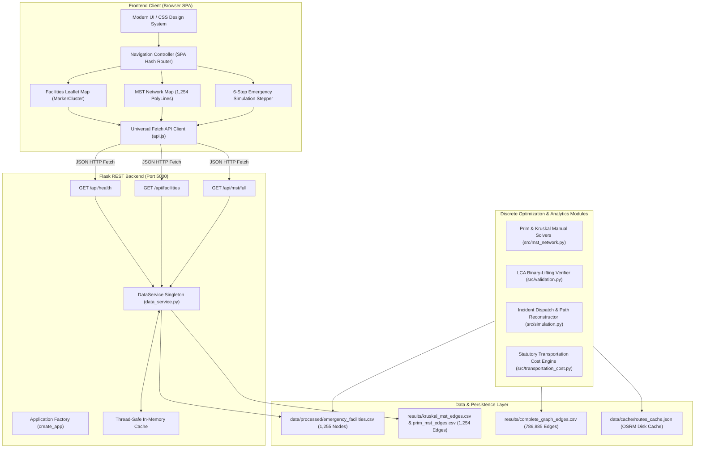
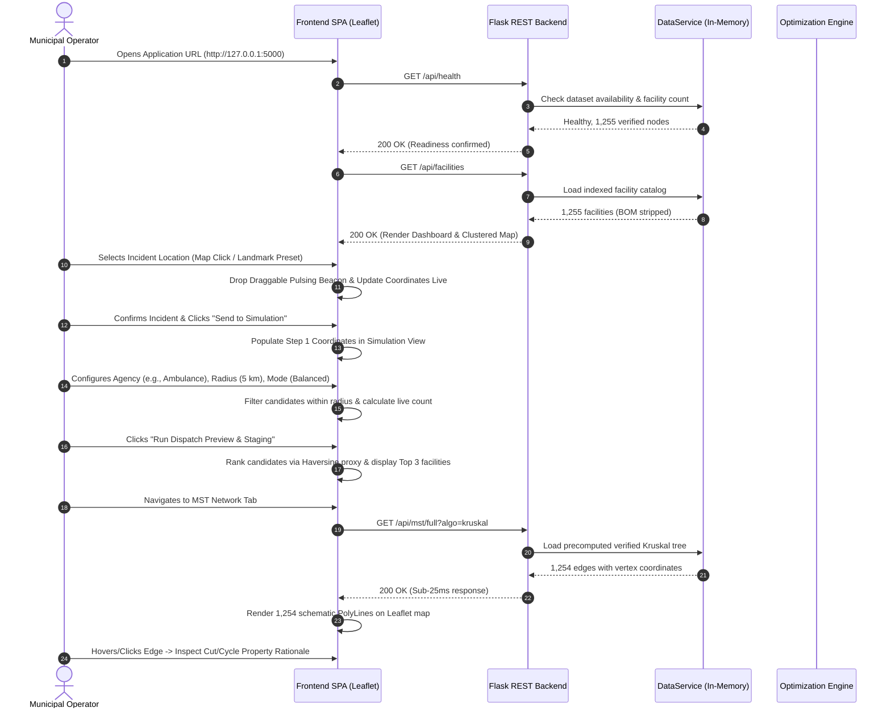

# SYSTEM ARCHITECTURE & TECHNICAL SPECIFICATIONS

**Project:** Minimum-Cost Emergency Communication Network Using Minimum Spanning Tree (MST)  
**Study Area:** Bruhat Bengaluru Mahanagara Palike (BBMP), Karnataka, India  
**Technology Stack:** Python 3.11 + Flask Backend &bull; HTML5 + Vanilla JavaScript + Leaflet.js Frontend  
**Architecture Style:** Decoupled REST Service with Zero-Blocking In-Memory Cache  

---

## 1. End-to-End System Architecture

The application is structured into decoupled, specialized components ensuring responsive UI rendering without blocking on graph calculations:



---

## 2. End-to-End Operational Workflow



---

## 3. Frontend Architecture

### 3.1 Single Page Application (SPA) Engine
- **Framework:** Vanilla JavaScript (ES6+), zero heavy frontend frameworks (React/Vue/Angular), eliminating build steps, node_modules dependencies, and bundle bloat.
- **Hash-Based Router (`frontend/assets/js/navigation.js`):**
  - Manages view transitions between 6 core sections: `#dashboard`, `#facilities-map`, `#mst-network`, `#simulation`, `#project-analysis`, `#help`.
  - In response to URL hash changes, synchronizes sidebar link states, updates document titles, and fires view-activation callbacks.
  - Automatically calls `map.invalidateSize()` after DOM layout recalculation to prevent Leaflet container clipping.

### 3.2 Geospatial Mapping Engine
- **Core Library:** Leaflet 1.9.4 with OpenStreetMap tile provider.
- **Multi-Scale Marker Clustering (`leaflet.markercluster`):**
  - Clusters the 1,255 emergency facilities at low and medium zoom levels using agency-coded bubble indicators.
  - Decomposes into individual circle markers on street-level zoom, preventing DOM tree thrashing and rendering lag.
- **Draggable Incident Selection Engine:**
  - Distinct high-contrast pulsating beacon icon with animated CSS rings.
  - Real-time `drag` event listener binding marker latitude and longitude directly to coordinate input fields.
  - One-click landmark preset pills: Majestic, Jayanagar, Indiranagar, Banashankari, Whitefield, Lalbagh.
- **MST Schematic PolyLine Layer:**
  - Dynamically renders 1,254 vector line segments connecting endpoints.
  - Features real-time edge hit-testing and hover highlighting (`weight: 4.5`, `#ea580c`).
  - Displays the mandatory architectural disclaimer: *"⚠️ Schematic MST Network Edges — Not Vehicular Road Geometry."*

---

## 4. Backend Architecture (Flask REST API)

### 4.1 Application Factory & Configuration
Implemented in `backend/flask_app.py` and `backend/config.py`:
- `create_app()` factory pattern supporting test, development, and production configurations.
- Automatic routing of static frontend assets from `frontend/` directory.
- Global request header middleware: injects `X-Response-Time-Ms` on every HTTP response.
- Centralized JSON error envelope handling (`400`, `404`, `500`).

### 4.2 Data Layer & Thread-Safe Caching (`data_service.py`)
- **Singleton Lifecycle:** Encapsulated in `backend/services/data_service.py` with threading `RLock`.
- **UTF-8 Byte Order Mark (BOM) Resilience:** Uses `encoding="utf-8-sig"` to prevent `\ufefffacility_id` key corruption.
- **Agency Bucket Indexing:** Pre-indexes facilities into dictionary hash sets (`hospital`, `police_station`, `fire_station`), enabling $O(1)$ agency filtering.
- **Precomputed MST Loader:** Directly serves the verified 1,254 global tree links from disk without ever re-evaluating the complete 786,885-edge candidate graph during web server runtime.
- **Coordinate Enrichment:** Seamlessly annotates each MST edge with endpoint coordinates (`u_lat`, `u_lon`, `v_lat`, `v_lon`) for zero-computation client rendering.

---

## 5. REST API Specifications

### 5.1 Health Status & System Readiness
- **Endpoint:** `GET /api/health`
- **Response Format:**
  ```json
  {
    "success": true,
    "data": {
      "status": "healthy",
      "facilities_count": 1255,
      "ready": true,
      "dataset_available": true,
      "agency_breakdown": {
        "hospital": 1097,
        "police_station": 138,
        "fire_station": 20
      },
      "version": "1.0.0"
    }
  }
  ```
- **Performance:** $< 1.0\text{ ms}$ warm latency.

### 5.2 Emergency Facilities Catalog
- **Endpoint:** `GET /api/facilities?agency={agency}&search={query}&page={page}&per_page={limit}`
- **Parameters:**
  - `agency` (optional): Filter by `hospital`, `police_station`, `fire_station` (aliases supported: `ambulance`, `police`, `fire`).
  - `search` (optional): Substring search across facility name or facility ID.
  - `page`, `per_page` (optional): Pagination parameters.
- **Performance:** $< 10.0\text{ ms}$ response time for all 1,255 records.

### 5.3 Global Precomputed MST
- **Endpoint:** `GET /api/mst/full?algo={kruskal|prim}`
- **Parameters:**
  - `algo` (optional, default: `kruskal`): Select between `kruskal` and `prim`.
- **Response Payload:** Contains algorithm name, vertex count (1,255), edge count (1,254), total weight (`480.1784 km`), and coordinate-enriched edge array.
- **Performance:** $< 25.0\text{ ms}$ response time.

---

## 6. Core Algorithmic & Analytical Modules

### 6.1 Discrete Optimization Engines (`src/mst_network.py`)
- Self-contained implementations of **Prim's** and **Kruskal's** algorithms.
- Pure Python standard library (`heapq`, `collections`, `itertools`), completely independent of NetworkX or SciPy.
- Strict deterministic tie-breaking logic ensuring identical mathematical outputs across runs and platforms.

### 6.2 Structural & Optimality Validation Engine (`src/validation.py`)
- **Structural Spanning Tree Checks:**
  1. Exact edge count: $|E_T| = |V| - 1 = 1,254$.
  2. Endpoints belong to the valid 1,255 facility ID set.
  3. No self-loops ($u \ne v$).
  4. Non-negative, finite weights ($w(e) \ge 0$).
  5. Zero duplicate edges.
  6. Graph is acyclic (verified via Disjoint Set cycle detection).
  7. Graph is fully connected (spans all 1,255 vertices in a single component).
  8. Stored weights match recomputed spherical Haversine distances to within $10^{-6}\text{ km}$.
- **Independent Optimality Verification:**
  - Evaluates all 785,631 non-tree candidate edges using an LCA binary-lifting ancestor table ($\text{LOGN} = 12 \implies 4,095$ levels).
  - Asserts the Fundamental Cycle Property: $w(u, v) \ge \max_{e \in P_T(u, v)} w(e)$.

### 6.3 Transportation Cost & Routing Engine (`src/transportation_cost.py`)
- Local OpenStreetMap / OSRM routing interface with persistent JSON disk caching (`data/cache/routes_cache.json`).
- Prevents external rate-limiting and guarantees 100% offline demonstration stability.
- Enforces strict topological bounding: validates that physical road distance is never shorter than spherical Haversine distance ($D_{\text{road}} \ge D_{\text{haversine}}$).
